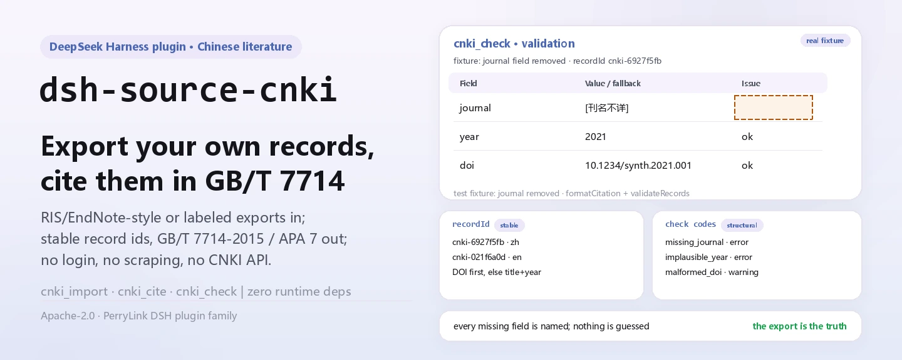
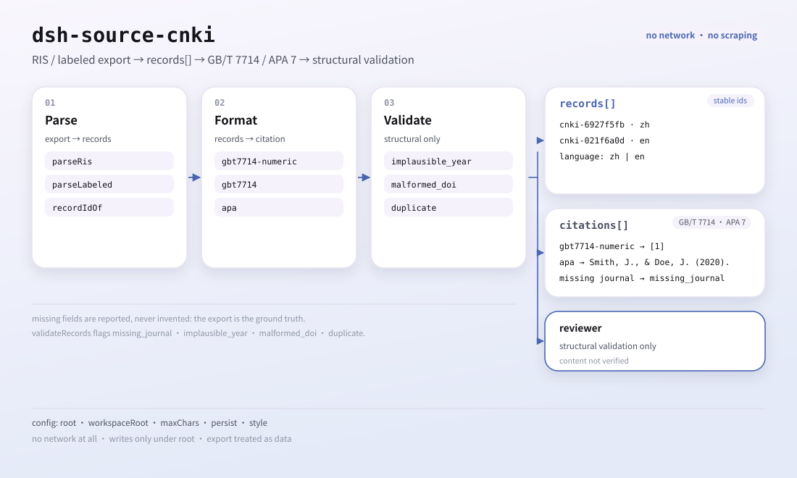
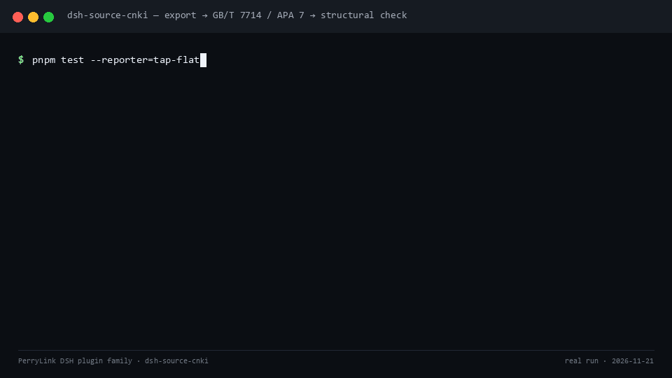

<div align="center">

<picture>
  <source media="(prefers-color-scheme: dark)" srcset="docs/assets/dsh-source-cnki-hero-en-dark.webp">
  
</picture>

# dsh-source-cnki

**Registros de literatura china: importa tu exportación, cítala en GB/T 7714, comprueba los metadatos — sin hacer scraping de CNKI.**

*Sin inicio de sesión, sin scraping, sin API de CNKI (no hay ninguna pública para este uso). El plugin lee exportaciones RIS/estilo EndNote o texto etiquetado, asigna ids de registro estables, formatea GB/T 7714-2015 (顺序编码制) o APA 7, y ejecuta validación estructural.*

[English](README.md) · [简体中文](README-zh.md) · [Español](README-es.md) · [Português](README-pt.md) · [हिन्दी](README-hi.md)

[](LICENSE)
[]()

</div>

---

## Decisión de alcance (léelo primero)

CNKI no tiene una API pública para este propósito. Por eso este plugin **no** inicia sesión, no hace scraping ni sortea ningún control de acceso. Tú exportas los registros (texto etiquetado RIS/estilo EndNote, o texto etiquetado con `题名：`/`作者：`/`来源：`), y el plugin trabaja sobre esa exportación. Si tu exportación carece de un campo, el plugin dice "missing" — nunca inventa una revista, año, volumen, rango de páginas ni DOI.

## Qué hace

- **`cnki_import`** — analiza exportaciones RIS/estilo EndNote y de texto etiquetado, asigna un `recordId` estable (basado en DOI si existe, si no en título+año), detecta el idioma y valida la estructura. La exportación se convierte en evidencia REP cuando `persist` está activo.
- **`cnki_cite`** — GB/T 7714-2015 顺序编码制 (`[1] 作者. 题名[J]. 刊名, 年, 卷(期): 页码.`), lo mismo sin numeración, o APA 7. Reglas de autores: GB/T hasta 3 todos, si no los 3 primeros + `等`/`et al`; los nombres occidentales pasan a `SURNAME I`; APA pasa a `Surname, I.`.
- **`cnki_check`** — validación estructural: título/revista/año/autores ausentes, año implausible, DOI mal formado, páginas no numéricas, duplicados, revista sin volumen ni número.


<picture>
  <source media="(prefers-color-scheme: dark)" srcset="docs/assets/dsh-source-cnki-flow-v5-dark.svg">
  
</picture>

*Estructura: analizar → formatear → validar; `records[]` y `citations[]` son las dos salidas, `validateRecords` reporta problemas estructurales, y no se inventa nada cuando falta un campo. Las etiquetas de token dentro del diagrama son los nombres reales de funciones y campos, así que la misma imagen sirve para los cinco idiomas.*

## Qué no hace

- **Ningún acceso a CNKI.** Sin inicio de sesión, sin cookies, sin scraping, sin endpoints no oficiales.
- **Sin verificación de contenido.** No comprueba que el registro coincida con el artículo real; usa `dsh-cite-verify` para DOIs.
- **Sin campos semánticos.** Sin recuentos de citas, factores de impacto ni números de financiación.
- **Sin DOCX/PDF.** Exporta como RIS/texto etiquetado (extracción de texto de PDF: `dsh-doc-anchor`).
- **Sin afirmar cobertura completa de GB/T.** Existen variantes (著者-出版年制, portadores [EB/OL], [J/OL] con URL); v0.1 implementa los casos comunes de revista/tesis/conferencia/libro y lo dice.

## Formatos

| Formato | Reconocido |
|---|---|
| RIS/EndNote | `TY`, `AU`, `TI`, `JO`, `PY`, `VL`, `IS`, `SP`, `EP`, `DO`, `KW`, `AB`, `ER` (la primera etiqueta gana por campo, los autores se acumulan) |
| Texto etiquetado | `题名`/`标题`/`篇名`, `作者`, `来源`/`刊名`, `年`/`发表时间`, `卷`, `期`, `页码`, `DOI`, `关键词`, `摘要`, `类型`; una línea en blanco separa registros |

Las etiquetas desconocidas se ignoran, no se adivinan.

## Herramientas

### `cnki_import`

`{ text? | path?, format?, persist? }` → `{ ok, records, validation, evidenceId?, recordPath? }`.

### `cnki_cite`

`{ records, style?, startIndex? }` → `{ ok, citations, text }`.

### `cnki_check`

`{ records }` → `{ ok, validation }`.

### Códigos de error

`INVALID_INPUT` · `NOT_FOUND` · `PATH_ESCAPE` · `NOT_A_FILE` · `TOO_LARGE` · `UNSUPPORTED_FILE` · `NO_RECORDS` · `STORE_ERROR`

## Compatibilidad e instalación

| | |
|---|---|
| DeepSeek Harness | **`dsh-v0.2.2-rc.4`** (verificado 2026-11-18); peer `>=0.2.1-0 <0.3.0 \|\| >=0.2.2-0 <0.3.0` |
| Node | `^22.19.0 \|\| >=24.9.0` (probado en `24.22.1`), solo ESM |
| Peers | `@perrylink/dsh-research-core ^0.1.0`, `@deepseek-ai/cordis ^4.0.5-alpha.1`, `@deepseek-ai/dsh-tools`, `@deepseek-ai/schemastery ^3.18.5-alpha.1` |
| Dependencias en tiempo de ejecución | **cero** |

```sh
dsh plugin --profile <name> add @perrylink/dsh-research-core dsh-source-cnki
dsh --profile <name> --dump-config | grep dsh-source-cnki
```

## Configuración

| Clave | Valor por defecto | Significado |
|---|---|---|
| `enabled` | `true` | `false` no monta nada |
| `root` | `.source-cnki` | raíz de almacén/registro |
| `workspaceRoot` | `process.cwd()` | las rutas deben resolverse dentro de ella |
| `maxChars` | `2000000` | tope de la exportación (falla, nunca trunca) |
| `persist` | `true` | guarda la exportación como evidencia REP + registro |
| `style` | `gbt7714-numeric` | estilo de cita por defecto |

## Límites de seguridad

- Sin red en absoluto: sin CNKI, sin resolución de DOI, sin telemetría.
- Solo lectura sobre la exportación; escrituras solo bajo `root`.
- Contención con `realpath`; DOCX/PDF se rechazan con una pista de conversión.
- La exportación es dato. El texto con forma de instrucción dentro de un título o resumen nunca se ejecuta (no hay ejecutor).

## Evaluación



*Animado: la ejecución real de `pnpm test --reporter=tap-flat` de la suite importación → GB/T 7714 / APA 7 → validación (sin red, sin acceso a CNKI; reejecutada el 2026-11-21). Cada línea `ok` es una prueba de la suite; los tiempos son de esta ejecución.*


**24 pruebas**: análisis RIS y de texto etiquetado (registros chinos e ingleses, exportaciones CRLF/BOM, ids basados en DOI, detección de idioma), detección automática y rechazo de vacío/no reconocido, cita de revista GB/T con páginas con guion, reglas de ≤3 vs >3 autores (等 / et al), marcador de revista ausente, marcador de tesis, numeración secuencial, autor/año/revista/volumen/DOI de APA, códigos de validación (título/revista ausentes, año implausible incluido futuro lejano, DOI mal formado, páginas impares, duplicados), runtime (registro REP válido, cite/check, rechazo de travesía/enlace simbólico/DOCX/tamaño excesivo, registros mal formados y texto `null` rechazados), esquemas de herramientas, import→cite→check de extremo a extremo, ramas de fallo, contrato del plugin, contrato del paquete.

No se declara ningún benchmark: la verdad de referencia es tu exportación; la corrección del formateador se comprueba contra las reglas GB/T anteriores con fixtures.

## Limitaciones conocidas (v0.1)

- GB/T 7714 著者-出版年制, portadores `[J/OL]`/`[EB/OL]` y reglas de abreviatura de revistas inglesas no están implementados.
- Los registros de conferencia y libro reutilizan el campo `journal` para actas/editorial (los formatos de exportación rara vez traen campos separados).
- El análisis es línea a línea; los resúmenes de varias líneas muy plegados en exportaciones etiquetadas pueden fusionarse con el campo anterior.
- No se conserva ningún id de registro de CNKI (`CNKI:`/`DBID`) más allá de lo que contenga la exportación.

## Licencia

Apache-2.0. Sin código de terceros en tiempo de ejecución.
