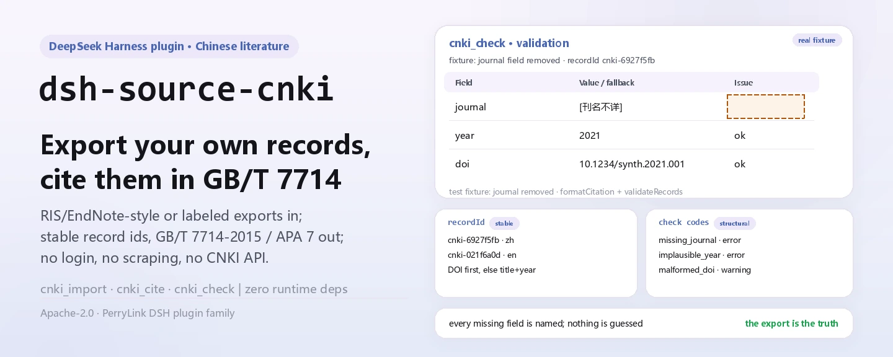
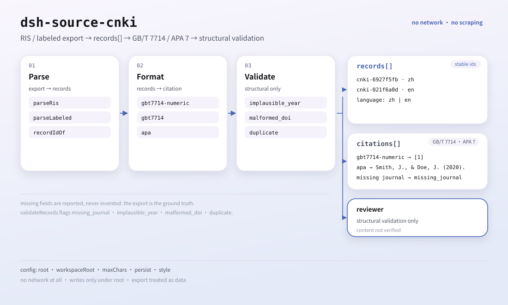
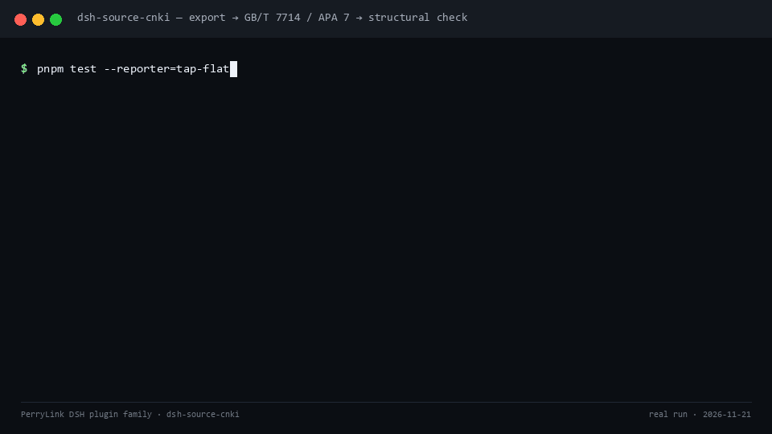

<div align="center">

<picture>
  <source media="(prefers-color-scheme: dark)" srcset="docs/assets/dsh-source-cnki-hero-en-dark.webp">
  
</picture>

# dsh-source-cnki

**चीनी साहित्य के रिकॉर्ड: अपना निर्यात आयात करें, GB/T 7714 में उद्धृत करें, मेटाडेटा जाँचें — CNKI को स्क्रैप किए बिना।**

*कोई लॉगिन नहीं, कोई स्क्रैपिंग नहीं, कोई CNKI API नहीं (इस उद्देश्य के लिए कोई सार्वजनिक API नहीं है)। प्लगइन RIS/EndNote-शैली या लेबल किए गए टेक्स्ट निर्यात पढ़ता है, स्थिर रिकॉर्ड ids देता है, GB/T 7714-2015 (顺序编码制) या APA 7 में फ़ॉर्मैट करता है, और संरचनात्मक सत्यापन चलाता है।*

[English](README.md) · [简体中文](README-zh.md) · [Español](README-es.md) · [Português](README-pt.md) · [हिन्दी](README-hi.md)

[](LICENSE)
[]()

</div>

---

## दायरा निर्णय (पहले पढ़ें)

CNKI के पास इस उद्देश्य के लिए कोई सार्वजनिक API नहीं है। इसलिए यह प्लगइन लॉगिन नहीं करता, स्क्रैप नहीं करता और किसी एक्सेस नियंत्रण को बायपास नहीं करता। रिकॉर्ड आप स्वयं निर्यात करते हैं (RIS/EndNote-शैली टैग टेक्स्ट, या `题名：`/`作者：`/`来源：` वाला लेबल टेक्स्ट), और प्लगइन उसी निर्यात पर काम करता है। अगर निर्यात में कोई फ़ील्ड नहीं है, तो प्लगइन "missing" कहता है — वह कभी पत्रिका, वर्ष, वॉल्यूम, पृष्ठ-सीमा या DOI नहीं गढ़ता।

## यह क्या करता है

- **`cnki_import`** — RIS/EndNote-शैली और लेबल टेक्स्ट निर्यात पार्स करता है, स्थिर `recordId` देता है (DOI हो तो उस पर आधारित, वरना शीर्षक+वर्ष), भाषा पहचानता है और संरचना सत्यापित करता है। `persist` चालू होने पर निर्यात REP एविडेंस बन जाता है।
- **`cnki_cite`** — GB/T 7714-2015 顺序编码制 (`[1] 作者. 题名[J]. 刊名, 年, 卷(期): 页码.`), वही बिना क्रमांकन के, या APA 7। लेखक नियम: GB/T में 3 तक सभी, वरना पहले 3 + `等`/`et al`; पश्चिमी नाम `SURNAME I` बनते हैं; APA में `Surname, I.` बनता है।
- **`cnki_check`** — संरचनात्मक सत्यापन: शीर्षक/पत्रिका/वर्ष/लेखक अनुपस्थित, असंभाव्य वर्ष, विकृत DOI, ग़ैर-संख्यात्मक पृष्ठ, डुप्लिकेट, बिना वॉल्यूम या अंक वाली पत्रिका।


<picture>
  <source media="(prefers-color-scheme: dark)" srcset="docs/assets/dsh-source-cnki-flow-v5-dark.svg">
  
</picture>

*संरचना: पार्स → फ़ॉर्मैट → सत्यापन; `records[]` और `citations[]` दो आउटपुट हैं, `validateRecords` संरचनात्मक समस्याएँ रिपोर्ट करता है, और फ़ील्ड अनुपस्थित होने पर कुछ भी नहीं गढ़ा जाता। डायग्राम के अंदर टोकन लेबल असली फ़ंक्शन और फ़ील्ड नाम हैं, इसलिए एक ही चित्र पाँचों भाषाओं के लिए काम आता है।*

## यह क्या नहीं करता

- **CNKI तक कोई पहुँच नहीं।** न लॉगिन, न कुकीज़, न स्क्रैपिंग, न अनौपचारिक एंडपॉइंट।
- **सामग्री का सत्यापन नहीं।** यह नहीं जाँचता कि रिकॉर्ड असली पेपर से मेल खाता है; DOIs के लिए `dsh-cite-verify` उपयोग करें।
- **कोई अर्थपूर्ण फ़ील्ड नहीं।** न उद्धरण-गणना, न इम्पैक्ट फ़ैक्टर, न फ़ंड संख्याएँ।
- **DOCX/PDF नहीं।** RIS/लेबल टेक्स्ट के रूप में निर्यात करें (PDF टेक्स्ट निष्कर्षण: `dsh-doc-anchor`)।
- **GB/T की पूर्णता का दावा नहीं।** इसके रूपांतर मौजूद हैं (著者-出版年制, [EB/OL] वाहक, URL वाला [J/OL]); v0.1 सामान्य पत्रिका/थीसिस/सम्मेलन/पुस्तक मामलों को लागू करता है और यही कहता है।

## फ़ॉर्मैट

| फ़ॉर्मैट | पहचाना जाता है |
|---|---|
| RIS/EndNote | `TY`, `AU`, `TI`, `JO`, `PY`, `VL`, `IS`, `SP`, `EP`, `DO`, `KW`, `AB`, `ER` (प्रति फ़ील्ड पहला टैग जीतता है, लेखक जुड़ते जाते हैं) |
| लेबल टेक्स्ट | `题名`/`标题`/`篇名`, `作者`, `来源`/`刊名`, `年`/`发表时间`, `卷`, `期`, `页码`, `DOI`, `关键词`, `摘要`, `类型`; खाली पंक्ति रिकॉर्ड अलग करती है |

अज्ञात टैग अनदेखे किए जाते हैं, अनुमान नहीं लगाए जाते।

## टूल

### `cnki_import`

`{ text? | path?, format?, persist? }` → `{ ok, records, validation, evidenceId?, recordPath? }`.

### `cnki_cite`

`{ records, style?, startIndex? }` → `{ ok, citations, text }`.

### `cnki_check`

`{ records }` → `{ ok, validation }`.

### त्रुटि कोड

`INVALID_INPUT` · `NOT_FOUND` · `PATH_ESCAPE` · `NOT_A_FILE` · `TOO_LARGE` · `UNSUPPORTED_FILE` · `NO_RECORDS` · `STORE_ERROR`

## संगतता और इंस्टॉल

| | |
|---|---|
| DeepSeek Harness | **`dsh-v0.2.2-rc.4`** (2026-11-18 को सत्यापित); peer `>=0.2.1-0 <0.3.0 \|\| >=0.2.2-0 <0.3.0` |
| Node | `^22.19.0 \|\| >=24.9.0` (`24.22.1` पर परीक्षित), केवल ESM |
| Peers | `@perrylink/dsh-research-core ^0.1.0`, `@deepseek-ai/cordis ^4.0.5-alpha.1`, `@deepseek-ai/dsh-tools`, `@deepseek-ai/schemastery ^3.18.5-alpha.1` |
| रनटाइम निर्भरताएँ | **शून्य** |

```sh
dsh plugin --profile <name> add @perrylink/dsh-research-core dsh-source-cnki
dsh --profile <name> --dump-config | grep dsh-source-cnki
```

## कॉन्फ़िगरेशन

| कुंजी | डिफ़ॉल्ट | अर्थ |
|---|---|---|
| `enabled` | `true` | `false` कुछ भी माउंट नहीं करता |
| `root` | `.source-cnki` | स्टोर/रिकॉर्ड का रूट |
| `workspaceRoot` | `process.cwd()` | पथ इसी के अंदर रिज़ॉल्व होने चाहिए |
| `maxChars` | `2000000` | निर्यात की सीमा (विफल होती है, कभी काटती नहीं) |
| `persist` | `true` | निर्यात को REP एविडेंस + रिकॉर्ड के रूप में संग्रहीत करता है |
| `style` | `gbt7714-numeric` | डिफ़ॉल्ट उद्धरण शैली |

## सुरक्षा सीमाएँ

- कोई नेटवर्क नहीं: न CNKI, न DOI रिज़ॉल्यूशन, न टेलीमेट्री।
- निर्यात पर केवल-पढ़ने की पहुँच; लेखन केवल `root` के अंतर्गत।
- `realpath` के साथ पथ-नियंत्रण; DOCX/PDF रूपांतरण संकेत के साथ अस्वीकृत।
- निर्यात डेटा है। शीर्षक या सार के अंदर निर्देश जैसा टेक्स्ट कभी निष्पादित नहीं होता (कोई निष्पादक नहीं है)।

## मूल्यांकन



*एनिमेटेड: आयात → GB/T 7714 / APA 7 → सत्यापन सुइट का असली `pnpm test --reporter=tap-flat` रन (कोई नेटवर्क नहीं, CNKI तक कोई पहुँच नहीं; 2026-11-21 को फिर से चलाया गया)। हर `ok` पंक्ति सुइट का एक टेस्ट है; समय इसी रन के हैं।*


**24 टेस्ट**: RIS और लेबल टेक्स्ट पार्सिंग (चीनी और अंग्रेज़ी रिकॉर्ड, CRLF/BOM निर्यात, DOI-आधारित ids, भाषा पहचान), स्वतः पहचान और खाली/अपरिचित निर्यात की अस्वीकृति, en-dash पृष्ठों वाला GB/T पत्रिका उद्धरण, ≤3 बनाम >3 लेखक नियम (等 / et al), अनुपस्थित-पत्रिका मार्कर, थीसिस मार्कर, क्रमिक क्रमांकन, APA का लेखक/वर्ष/पत्रिका/वॉल्यूम/DOI, सत्यापन कोड (शीर्षक/पत्रिका अनुपस्थित, दूर-भविष्य सहित असंभाव्य वर्ष, विकृत DOI, विषम पृष्ठ, डुप्लिकेट), रनटाइम (वैध REP रिकॉर्ड, cite/check, traversal/सिमलिंक/DOCX/अति-आकार अस्वीकृति, विकृत रिकॉर्ड और `null` टेक्स्ट अस्वीकृत), टूल स्कीमा, import→cite→check एंड-टू-एंड, विफलता शाखाएँ, प्लगइन अनुबंध, पैकेज अनुबंध।

कोई बेंचमार्क घोषित नहीं है: आधार-सत्य आपका निर्यात है; फ़ॉर्मैटर की सटीकता ऊपर के GB/T नियमों के विरुद्ध fixtures से जाँची जाती है।

## ज्ञात सीमाएँ (v0.1)

- GB/T 7714 著者-出版年制, `[J/OL]`/`[EB/OL]` वाहक और अंग्रेज़ी पत्रिका-संक्षेपण नियम लागू नहीं हैं।
- सम्मेलन और पुस्तक रिकॉर्ड कार्यवाही/प्रकाशक के लिए `journal` फ़ील्ड का पुन: उपयोग करते हैं (निर्यात फ़ॉर्मैट में अलग फ़ील्ड शायद ही होते हैं)।
- पार्सिंग पंक्ति-उन्मुख है; लेबल निर्यात में बहुत मुड़े बहु-पंक्ति सार पिछले फ़ील्ड में मिल सकते हैं।
- निर्यात में मौजूद सामग्री से आगे कोई CNKI रिकॉर्ड id (`CNKI:`/`DBID`) संरक्षित नहीं होता।

## लाइसेंस

Apache-2.0. रनटाइम पर कोई तृतीय-पक्ष कोड नहीं।
