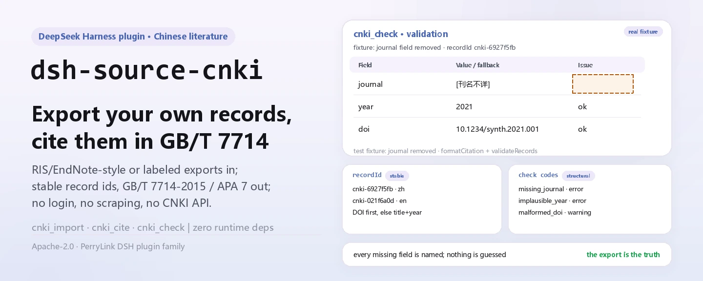
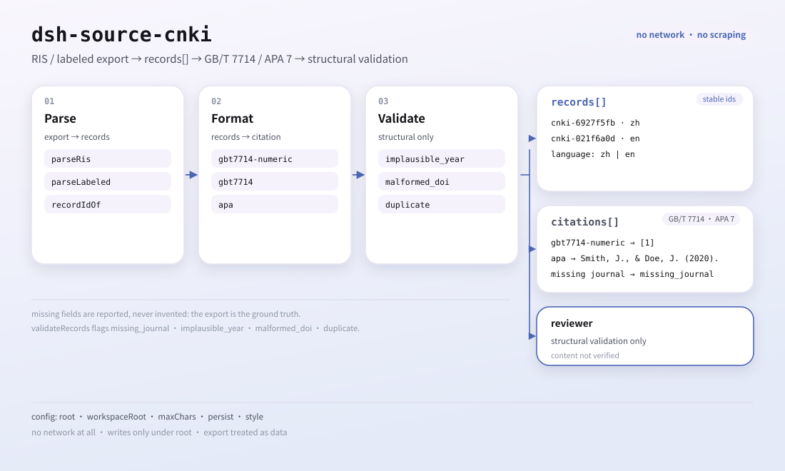
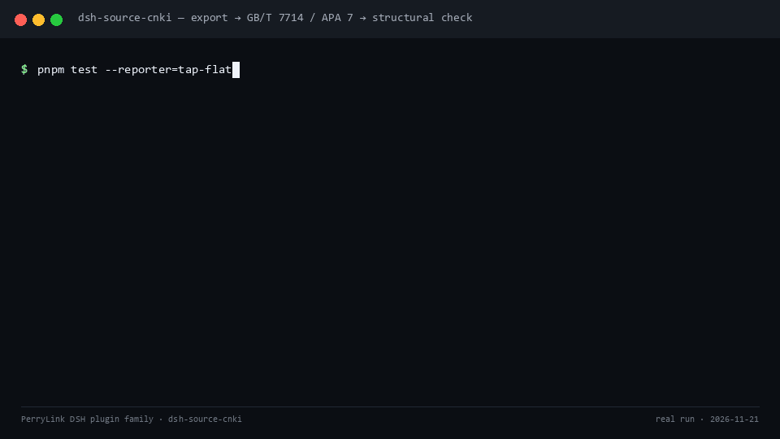

<div align="center">

<picture>
  <source media="(prefers-color-scheme: dark)" srcset="docs/assets/dsh-source-cnki-hero-en-dark.webp">
  
</picture>

# dsh-source-cnki

**Registros de literatura chinesa: importe sua exportação, cite em GB/T 7714, verifique os metadados — sem fazer scraping do CNKI.**

*Sem login, sem scraping, sem API do CNKI (não há nenhuma pública para este uso). O plugin lê exportações RIS/estilo EndNote ou texto rotulado, atribui ids de registro estáveis, formata GB/T 7714-2015 (顺序编码制) ou APA 7, e executa validação estrutural.*

[English](README.md) · [简体中文](README-zh.md) · [Español](README-es.md) · [Português](README-pt.md) · [हिन्दी](README-hi.md)

[](LICENSE)
[]()

</div>

---

## Decisão de escopo (leia primeiro)

O CNKI não tem API pública para este propósito. Por isso este plugin **não** faz login, não faz scraping e não contorna nenhum controle de acesso. Você exporta os registros (texto rotulado RIS/estilo EndNote, ou texto rotulado com `题名：`/`作者：`/`来源：`), e o plugin trabalha sobre essa exportação. Se a exportação não tiver um campo, o plugin diz "missing" — nunca inventa periódico, ano, volume, intervalo de páginas ou DOI.

## O que faz

- **`cnki_import`** — analisa exportações RIS/estilo EndNote e de texto rotulado, atribui um `recordId` estável (baseado em DOI quando presente, senão título+ano), detecta o idioma e valida a estrutura. A exportação vira evidência REP quando `persist` está ligado.
- **`cnki_cite`** — GB/T 7714-2015 顺序编码制 (`[1] 作者. 题名[J]. 刊名, 年, 卷(期): 页码.`), o mesmo sem numeração, ou APA 7. Regras de autores: GB/T até 3 todos, senão os 3 primeiros + `等`/`et al`; nomes ocidentais viram `SURNAME I`; APA vira `Surname, I.`.
- **`cnki_check`** — validação estrutural: título/periódico/ano/autores ausentes, ano implausível, DOI malformado, páginas não numéricas, duplicatas, periódico sem volume nem número.

<picture>
  <source media="(prefers-color-scheme: dark)" srcset="docs/assets/dsh-source-cnki-flow-v5-dark.svg">
  
</picture>

*Estrutura: analisar → formatar → validar; `records[]` e `citations[]` são as duas saídas, `validateRecords` reporta problemas estruturais, e nada é inventado quando um campo falta. Os rótulos de token dentro do diagrama são os nomes reais de funções e campos, então a mesma imagem serve aos cinco idiomas.*

## O que não faz

- **Nenhum acesso ao CNKI.** Sem login, sem cookies, sem scraping, sem endpoints não oficiais.
- **Sem verificação de conteúdo.** Não confere se o registro corresponde ao artigo real; use `dsh-cite-verify` para DOIs.
- **Sem campos semânticos.** Sem contagens de citações, fatores de impacto ou números de fomento.
- **Sem DOCX/PDF.** Exporte como RIS/texto rotulado (extração de texto de PDF: `dsh-doc-anchor`).
- **Sem alegar cobertura completa do GB/T.** Existem variantes (著者-出版年制, portadores [EB/OL], [J/OL] com URL); a v0.1 implementa os casos comuns de periódico/tese/conferência/livro e diz isso.

## Formatos

| Formato | Reconhecido |
|---|---|
| RIS/EndNote | `TY`, `AU`, `TI`, `JO`, `PY`, `VL`, `IS`, `SP`, `EP`, `DO`, `KW`, `AB`, `ER` (a primeira tag vence por campo, os autores se acumulam) |
| Texto rotulado | `题名`/`标题`/`篇名`, `作者`, `来源`/`刊名`, `年`/`发表时间`, `卷`, `期`, `页码`, `DOI`, `关键词`, `摘要`, `类型`; uma linha em branco separa registros |

Tags desconhecidas são ignoradas, não adivinhadas.

## Ferramentas

### `cnki_import`

`{ text? | path?, format?, persist? }` → `{ ok, records, validation, evidenceId?, recordPath? }`.

### `cnki_cite`

`{ records, style?, startIndex? }` → `{ ok, citations, text }`.

### `cnki_check`

`{ records }` → `{ ok, validation }`.

### Códigos de erro

`INVALID_INPUT` · `NOT_FOUND` · `PATH_ESCAPE` · `NOT_A_FILE` · `TOO_LARGE` · `UNSUPPORTED_FILE` · `NO_RECORDS` · `STORE_ERROR`

## Compatibilidade e instalação

| | |
|---|---|
| DeepSeek Harness | **`dsh-v0.2.3-alpha.1`** (verificado em 2026-11-22); peer `>=0.2.1-0 <0.3.0 \|\| >=0.2.2-0 <0.3.0` |
| Node | `^22.19.0 \|\| >=24.9.0` (testado em `24.22.1`), somente ESM |
| Peers | `@perrylink/dsh-research-core ^0.1.0`, `@deepseek-ai/cordis ^4.0.5-alpha.1`, `@deepseek-ai/dsh-tools`, `@deepseek-ai/schemastery ^3.18.5-alpha.1` |
| Dependências em tempo de execução | **zero** |

```sh
dsh plugin --profile <name> add @perrylink/dsh-research-core dsh-source-cnki
dsh --profile <name> --dump-config | grep dsh-source-cnki
```

## Configuração

| Chave | Padrão | Significado |
|---|---|---|
| `enabled` | `true` | `false` não monta nada |
| `root` | `.source-cnki` | raiz de armazenamento/registro |
| `workspaceRoot` | `process.cwd()` | os caminhos devem resolver dentro dela |
| `maxChars` | `2000000` | limite da exportação (falha, nunca trunca) |
| `persist` | `true` | armazena a exportação como evidência REP + registro |
| `style` | `gbt7714-numeric` | estilo de citação padrão |

## Limites de segurança

- Nenhuma rede: sem CNKI, sem resolução de DOI, sem telemetria.
- Somente leitura sobre a exportação; escritas apenas sob `root`.
- Contenção com `realpath`; DOCX/PDF rejeitados com uma dica de conversão.
- A exportação é dado. Texto com aparência de instrução dentro de um título ou resumo nunca é executado (não há executor).

## Avaliação



*Animado: a execução real de `pnpm test --reporter=tap-flat` da suíte importação → GB/T 7714 / APA 7 → validação (sem rede, sem acesso ao CNKI; reexecutada em 2026-11-21). Cada linha `ok` é um teste da suíte; os tempos são desta execução.*

**24 testes**: análise RIS e de texto rotulado (registros chineses e ingleses, exportações CRLF/BOM, ids baseados em DOI, detecção de idioma), detecção automática e rejeição de vazio/não reconhecido, citação de periódico GB/T com páginas em travessão, regras de ≤3 vs >3 autores (等 / et al), marcador de periódico ausente, marcador de tese, numeração sequencial, autor/ano/periódico/volume/DOI da APA, códigos de validação (título/periódico ausentes, ano implausível incluindo futuro distante, DOI malformado, páginas ímpares, duplicatas), runtime (registro REP válido, cite/check, rejeição de travessia/link simbólico/DOCX/tamanho excessivo, registros malformados e texto `null` rejeitados), esquemas de ferramentas, import→cite→check de ponta a ponta, ramos de falha, contrato do plugin, contrato do pacote.

Nenhum benchmark é alegado: a verdade de referência é a sua exportação; a correção do formatador é verificada contra as regras GB/T acima com fixtures.

## Limitações conhecidas (v0.1)

- GB/T 7714 著者-出版年制, portadores `[J/OL]`/`[EB/OL]` e regras de abreviação de periódicos ingleses não estão implementados.
- Registros de conferência e livro reutilizam o campo `journal` para anais/editora (os formatos de exportação raramente trazem campos separados).
- A análise é linha a linha; resumos de várias linhas muito dobrados em exportações rotuladas podem se fundir com o campo anterior.
- Nenhum id de registro do CNKI (`CNKI:`/`DBID`) é preservado além do que a exportação contém.

## Licença

Apache-2.0. Sem código de terceiros em tempo de execução.
